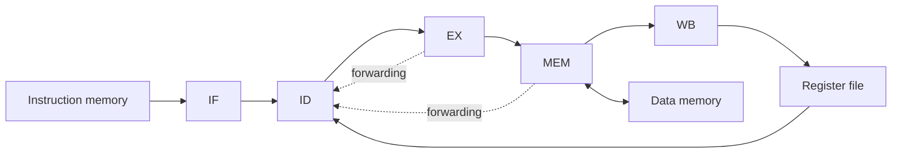

# RV32I Processor Simulator

An educational Python simulator that executes the same RV32I program on a single-stage core and a five-stage pipelined core, then compares architectural state and performance.

The simulator exposes what is usually hidden inside a processor: instruction decoding, register and memory updates, pipeline state, data hazards, forwarding decisions, stalls, and cycle-by-cycle traces.

## Implemented instruction subset

| Format | Instructions |
| --- | --- |
| R-type | `ADD`, `SUB`, `XOR`, `OR`, `AND` |
| I-type | `ADDI`, `XORI`, `ORI`, `ANDI` |
| Memory | `LW`, `SW` |
| Control flow | `BEQ`, `BNE`, `JAL` |

The five-stage implementation models instruction fetch, decode, execute, memory access, and writeback. Decode includes forwarding and hazard checks so dependent instructions can either consume an available result or introduce a bubble when required.

## Architecture



Both cores consume the same instruction and data memories. After execution, the simulator writes register snapshots, memory dumps, pipeline traces, and CPI/IPC summaries for comparison.

## Run

Python 3.10 or newer is sufficient; the simulator uses only the standard library.

```bash
python code/main.py --iodir code
```

The input directory must contain:

```text
imem.txt  One 8-bit binary instruction-memory value per line
dmem.txt  One 8-bit binary data-memory value per line
```

Three additional programs with reference outputs are included under `Sample_Testcases_SS_FS/`.

## Generated outputs

The `submissions/` directory contains:

| File | Contents |
| --- | --- |
| `SS_RFResult.txt`, `FS_RFResult.txt` | Register-file state after each cycle |
| `SS_DMEMResult.txt`, `FS_DMEMResult.txt` | Final data-memory dumps |
| `StateResult_SS.txt`, `StateResult_FS.txt` | Single-stage and pipeline state traces |
| `PerformanceMetrics_Result.txt` | Cycles, instructions, CPI, and IPC |

## Sample performance

The included reference programs demonstrate how fill, drain, control-flow, and hazard costs affect the pipelined core in this functional simulator:

| Test case | Instructions | Single-stage cycles | Five-stage cycles | Five-stage CPI |
| --- | ---: | ---: | ---: | ---: |
| 0 | 5 | 6 | 10 | 2.000 |
| 1 | 39 | 40 | 46 | 1.179 |
| 2 | 27 | 28 | 38 | 1.407 |

These values are simulator cycle counts, not hardware wall-clock timings.

## Verification

Core ALU, immediate, and representation helpers have deterministic unit tests:

```bash
python -m unittest discover -s tests -v
```

GitHub Actions runs the test suite on Python 3.10, 3.11, and 3.12. The [project report](Report.pdf) contains the design discussion and output analysis.

## Scope

This project implements the documented RV32I subset for coursework and architectural exploration. It is not an ISA-complete emulator and does not model caches, interrupts, privileged execution, branch prediction, or physical timing.
